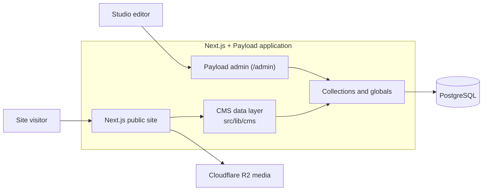

<h1 align="center">CrownForge Studio</h1>

<p align="center">
  <strong>CrownForge Studio website.</strong><br />
  A content-managed studio site built with Next.js and Payload CMS, with media served from Cloudflare R2.
</p>

<p align="center">
  <a href="https://crownforge.in">Live site</a>
</p>

The CrownForge Studio website presents the studio, its games, the characters and objects
from those games, the team, news, and development updates. The public pages are built with
Next.js and React; Payload CMS owns the content. Everything an editor changes in `/admin`
is reflected on the public site without a code change.

## Architecture



Public pages read **published** content only. Drafts are never exposed. The files in
`src/config/` (games, team, social links, studio copy) are a safety net: they are used only
while a collection has never been filled or the database cannot be reached. Once content
exists in Payload, the CMS is the source of truth.

## Content model

| Content           | Payload                       | Public routes                    |
| ----------------- | ----------------------------- | -------------------------------- |
| Games             | `studio-games` ("Games")      | `/games`, `/games/[slug]`        |
| Characters        | `characters`                  | `/characters`, `/characters/[slug]` |
| Objects / assets  | `objects`                     | `/objects`, `/objects/[slug]`    |
| Team              | `team-members`                | `/team`                          |
| News              | `news`                        | `/news`, `/news/[slug]`          |
| Development       | `development-updates`         | `/development`, `/development/[slug]` |
| Studio settings   | `website-settings` (global)   | header, footer, home, contact, SEO, `llms.txt` |
| Images            | `media-assets`                | used by all of the above         |

Sections without published content show an empty state; nothing is invented. There is no
public Media page.

## Tech stack

| Layer          | Technology                                                |
| -------------- | --------------------------------------------------------- |
| Web            | Next.js 16, React 19, JavaScript/TypeScript, Tailwind CSS |
| CMS and API    | Payload CMS 3, REST, GraphQL, Lexical                     |
| Database       | PostgreSQL via Payload's Postgres adapter                 |
| Object storage | Cloudflare R2 through the S3-compatible adapter           |
| Analytics      | PostHog, Vercel Analytics, and Vercel Speed Insights      |
| Infrastructure | Railway                                                   |
| Quality        | Vitest, Playwright, ESLint, generated Payload types       |

## Project map

```text
src/app/(public)/              public routes and server-rendered entry points
src/app/(payload)/             Payload admin, REST, and GraphQL routes
src/features/publicSite/       pages, sections, UI components
src/collections/               Payload collections
src/globals/                   Payload globals (Website Settings, legacy)
src/lib/cms/                   CMS data layer used by the public site
src/config/                    fallback content (used only until the CMS is filled)
src/scripts/                   seed and maintenance commands
tests/int/                     integration tests
tests/e2e/                     browser and route tests
docs/CROWNFORGE_ROADMAP.md     project roadmap (single canonical file)
```

## Run locally

Requirements: Node.js 22+, pnpm 9 or 10 (npm also works), and a PostgreSQL database.

```bash
pnpm install
cp .env.example .env
pnpm dev
```

Set at least `PAYLOAD_SECRET`, `DATABASE_URL`, and `NEXT_PUBLIC_SITE_URL` in `.env`,
then open `http://localhost:3000`. The Payload admin panel is available at `/admin`.

R2 is optional during local development. Without its five storage variables the R2
adapter is disabled and the rest of the application still runs against PostgreSQL.

| Variable                            | Purpose                             |
| ----------------------------------- | ----------------------------------- |
| `PAYLOAD_SECRET`                    | signs Payload authentication tokens |
| `DATABASE_URL`                      | PostgreSQL connection string        |
| `NEXT_PUBLIC_SITE_URL`              | canonical application URL           |
| `ALLOWED_ORIGINS`                   | extra admin origins for Payload CSRF (comma-separated) |
| `NEXT_PUBLIC_POSTHOG_PROJECT_TOKEN` | optional PostHog project token      |
| `R2_BUCKET`                         | R2 bucket name                      |
| `R2_PUBLIC_URL`                     | public base URL for stored media    |
| `S3_ACCESS_KEY_ID`                  | R2 S3-compatible access key         |
| `S3_SECRET_ACCESS_KEY`              | R2 S3-compatible secret             |
| `S3_ENDPOINT`                       | account-specific R2 endpoint        |

## Useful commands

```bash
pnpm dev                    # start Next.js and Payload in development
pnpm build                  # create a production build
pnpm generate:types         # regenerate Payload TypeScript definitions
pnpm lint                   # run ESLint (see AGENTS.md for a known config issue)
pnpm test:int               # run Vitest integration tests
pnpm test:e2e               # run Playwright browser tests
pnpm test                   # run both test suites
```

## Deployment

`railway.json` builds and starts the Next.js/Payload web service, with `/api/health` used
as the health check. In production, database schema push is disabled, so schema changes
need a Payload migration (see the roadmap).

## Legacy backend code

This repository was started from an earlier project. A scheduled game-metrics sync
(`src/lib/runtime/`, `railway.cron.json`, `pnpm runtime:refresh`) and the matching admin
group "Legacy" remain in place because they are still wired into the build and database.
They are **not** used by any public CrownForge page. See the roadmap for the cleanup plan.